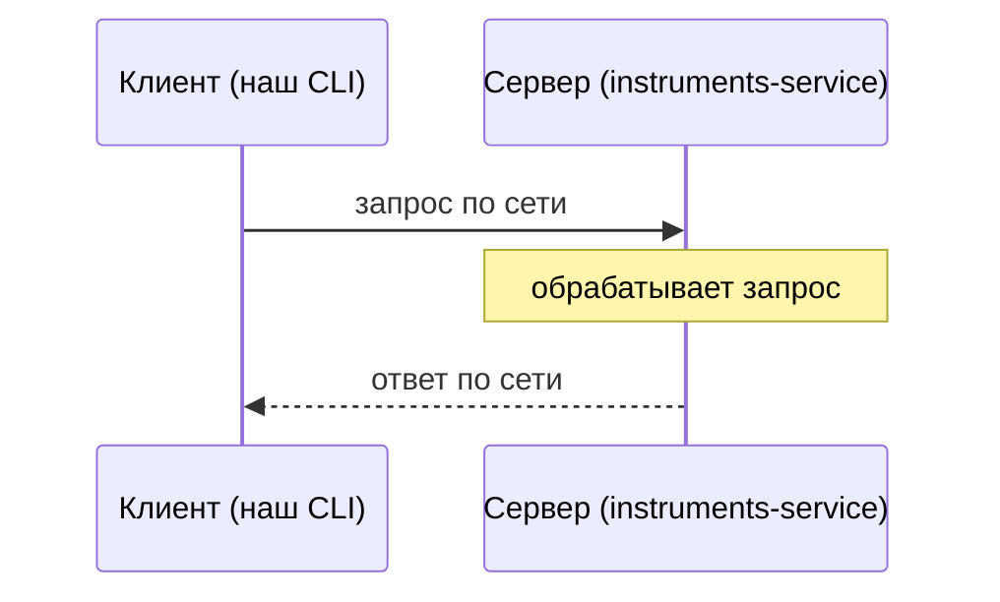
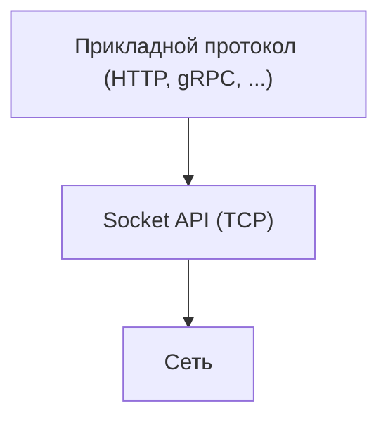
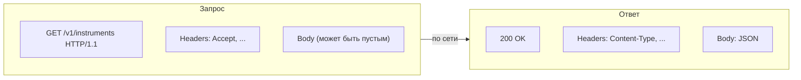

# Основы сетевого взаимодействия

---

## Клиент и сервер



| Сегодня                                                        | Потом                                     |
|----------------------------------------------------------------|-------------------------------------------|
| Пишем **клиентов** (`HttpClient`, затем Feign/OkHttp на выбор) | Пишем **сервер**                          |
| Моковый сервер — готовая чужая реализация                      | `instruments-service` разбирается изнутри |

---

## Транспорт: сокеты и TCP



---

## HTTP: запрос и ответ



| Часть         | Запрос                   | Ответ                |
|---------------|--------------------------|----------------------|
| Статус-строка | метод + путь             | код ответа           |
| Заголовки     | формат тела, авторизация | `Content-Type` и др. |
| Тело          | обычно пусто (`GET`)     | JSON                 |

---

## Как это видно в Java: `HttpClient`

```java
void example() {
    HttpRequest request = HttpRequest.newBuilder()
            .uri(URI.create(baseUrl + "/v1/instruments"))
            .header("Accept", "application/json")
            .GET()
            .build();

    HttpResponse<String> response = httpClient.send(request, HttpResponse.BodyHandlers.ofString());
}
```

Полная реализация — `HttpClientTInvestApiClient.java`, разбирается на этапе 2.
