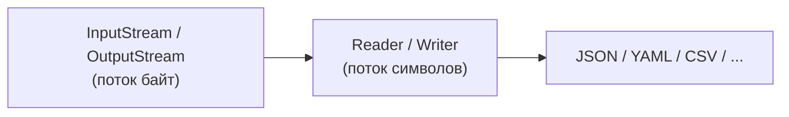

# Форматы данных и файловый ввод-вывод

---

## Байты vs символы



```java
void example() throws IOException {
    try (OutputStream out = Files.newOutputStream(path)) {
        out.write("SBER;250.00".getBytes());
    }
}
```

---

## Какие бывают форматы

| Формат          | Читается глазами | Для чего обычно                                  |
|-----------------|------------------|--------------------------------------------------|
| Бинарный (свой) | нет              | компактность, максимальный контроль над разбором |
| JSON / YAML     | да               | конфиги, обмен данными между сервисами           |
| CSV             | да (как таблица) | табличные данные, экспорт в Excel                |

---

## Jackson `ObjectMapper`: один API, оба формата

```java
void example() throws IOException {
    ObjectMapper json = new ObjectMapper();
    ObjectMapper yaml = new ObjectMapper(new YAMLFactory());

    json.writeValue(path.toFile(), prices);   // {"SBER":"250.00", ...}
    yaml.writeValue(path.toFile(), prices);   // SBER: "250.00" ...
}
```

|                          | JSON                 | YAML                                  |
|--------------------------|----------------------|---------------------------------------|
| Код                      | `new ObjectMapper()` | `new ObjectMapper(new YAMLFactory())` |
| `writeValue`/`readValue` | без изменений        | без изменений                         |

---

## CSV: не велосипед на `split(",")`

```java
void example() throws IOException {
    try (CSVPrinter printer = new CSVPrinter(Files.newBufferedWriter(path),
            CSVFormat.DEFAULT.builder().setHeader("ticker", "price").build())) {
        printer.printRecord("SBER", "250.00");
    }
}
```

|                                 | `split(",")` | `commons-csv` |
|---------------------------------|--------------|---------------|
| Запятая/кавычки внутри значения | ломается     | обрабатывает  |
