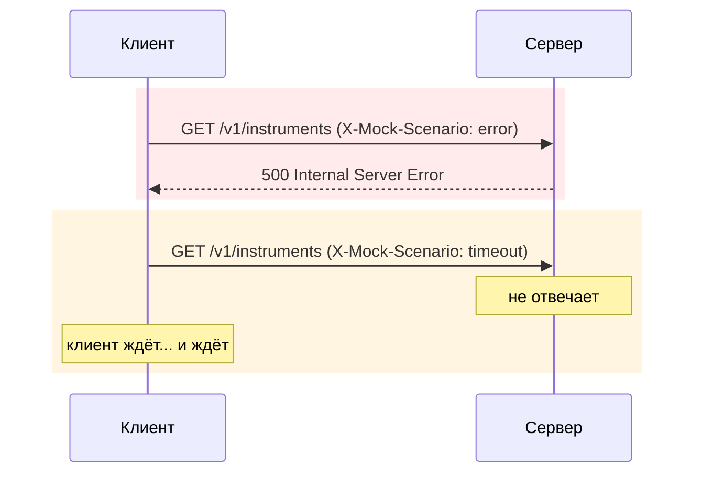
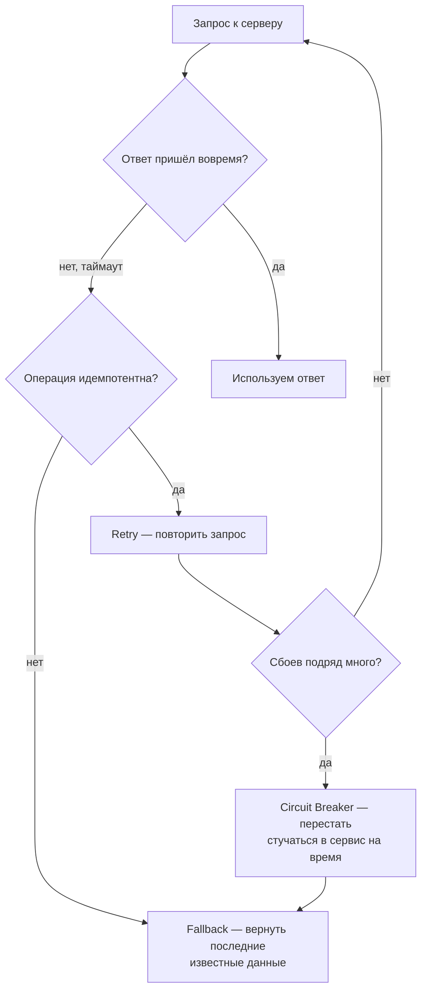

# Что делать, если сервер сбоит

---

## Два сценария, которые мы только что увидели

Наш клиент (`HttpClientTInvestApiClient`) сбой **обнаруживает**: `500` и обрыв по таймауту запроса
(5 с) превращаются в `TInvestApiException`. Но дальше ничего не происходит — ни повторной попытки, ни
запасного ответа, ни защиты от лавины запросов.

---

## Что обычно с этим делают

| Паттерн             | Коротко                                                                                               |
|---------------------|-------------------------------------------------------------------------------------------------------|
| **Timeout**         | не ждать ответ вечно — разорвать соединение через разумное время                                      |
| **Retry**           | повторить запрос при сбое — только для идемпотентных операций (`GET`, а не «купить ещё раз»)          |
| **Circuit Breaker** | после серии сбоев перестать стучаться в сервис какое-то время, а не долбить падающий сервис запросами |
| **Fallback**        | отдать что-то осмысленное вместо ошибки — например, последние закешированные данные                   |

---

## Сегодня / потом

Сегодня — просто увидели, что проблема существует. Разбор самих паттернов (`Retry`,
`Circuit Breaker` и т.д.) и их реализация — тема будущих семинаров.
